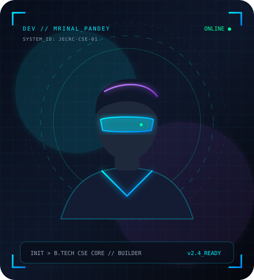

# Mrinal Pandey - Futuristic Developer Portfolio

A premium, award-winning, responsive personal portfolio website created for **Mrinal Pandey**, a 1st-year B.Tech CSE Core student at **JECRC University, Jaipur**.

---

## 🚀 Live Preview & Running Locally

This portfolio is built with pure, ultra-fast **HTML5, CSS3, Modern ES6+ JavaScript, and SVG vector graphics**. It requires **zero installation**, zero dependencies, and zero build commands.

- Simply double-click **`index.html`** in any web browser (Chrome, Edge, Firefox, Safari) to launch the website.
- Or host it free on **GitHub Pages**, **Vercel**, or **Netlify** by dragging and dropping this folder.

---

## 📂 Architecture & Webpage Structure

```
Mrinalportfolio/
├── index.html            # Home: Hero, animated brand title, personal quotes, avatar frame, quick metrics
├── about.html            # About Me: Education roadmap, Vidhani/Jaipur live clock, ambition card, hobbies
├── skills.html           # Skills: Interactive level indicators, category filter tabs, developer arsenal
├── projects.html         # Projects: Flagship Airfare Index showcase, live demo/repo links, concepts
├── achievements.html     # Achievements: SIH Prelims Top 15 spotlight (Team KaseKaabe), trophy visual
├── contact.html          # Contact: Glassmorphic transmission form, hidden phone cipher decryptor
├── README.md             # Guide & editing documentation
└── assets/
    ├── css/
    │   ├── style.css     # Global design system, variables, glassmorphism, responsive navbar & footer
    │   ├── pages.css     # Dedicated layouts for hero, timeline, cards, decryptor, and trophy
    │   └── botpress.css  # Futuristic theme & responsive position overrides for Botpress Webchat
    ├── js/
    │   ├── main.js       # Active navbar link highlighter, mobile drawer, custom cursor, smooth veil
    │   ├── particles.js  # Canvas cyber constellation network with interactive mouse repulsion
    │   ├── interactions.js # 3D card tilts, number counters, phone cipher decryptor, live clock, form toast
    │   └── botpress.js   # Official Botpress Webchat loader & initialization script
    └── images/
        ├── avatar-placeholder.svg # Futuristic glowing developer silhouette & HUD
        ├── sih-trophy.svg         # Animated Smart India Hackathon trophy vector
        └── airfare-preview.svg    # Modern flight analytics & telemetry UI preview
```

---

## 🎨 Design System & Visual Highlights

- **Aesthetic**: Deep Obsidian (`#05070d`) with Cyber Cyan (`#00f0ff`), Neon Violet (`#9d4edd`), and Emerald (`#00ff9d`) accents.
- **Micro-Interactions**:
  - **Dynamic Particle Constellation**: 60 FPS HTML5 Canvas stars and connective network responding to cursor physics.
  - **Smooth Lerping Custom Cursor**: Interactive glowing cursor ring with magnetic hover states over clickable cards and buttons (disabled automatically on touchscreen devices).
  - **Perspective 3D Card Tilts**: Mouse-tracking tilt and specular lighting on projects, skills, and honors.
  - **Phone Number Decryptor**: Keeps phone number `8521528645` protected behind an interactive cyber glitch decipher mechanism with one-click copy.
  - **Real-Time Jaipur Clock**: Dynamically updates live Indian Standard Time (IST) on the About page.
  - **Scroll-Triggered Animated Counters**: Smooth roll-up numbers for academic distinction (90%) and SIH rank (Top 15).

---

## ✏️ How to Personalize & Edit

### 1. Adding Your Real Photo
1. Place your image (e.g. `mrinal.jpg`) inside the `assets/images/` folder.
2. Open `index.html` and search for:
   ```html
   
   ```
3. Change it to:
   ```html
   
   ```

### 2. Updating Social Media Links
In any HTML file's footer (or `contact.html`), replace `https://linkedin.com` and `https://github.com` with your exact profile URLs:
- `https://linkedin.com/in/your-username`
- `https://github.com/your-username`

### 3. Adding New Projects or Skills
- Projects can be added or edited directly in `projects.html` inside `<div class="projects-grid">`.
- New skill categories or percentage bars can be customized in `skills.html` by updating `data-width="80%"` on `.skill-progress-fill`.

### 4. Configuring Your Botpress AI Assistant
The official Botpress integration is wired into all 6 pages via `assets/js/botpress.js` and `assets/css/botpress.css`.
To activate your bot:
1. Open `assets/js/botpress.js`.
2. Add your Botpress Webchat inject script URL and config script URL (or initialization block).
3. Set `isConfigured: true`.
4. Open any page in your browser — the floating AI assistant widget will appear in the bottom-right corner with the custom cyberpunk neon glow!

---

## 🏆 Standout Student Honors Included

1. **Smart India Hackathon (SIH) Prelims**: Reached **Top 15 Teams** with team **"KaseKaabe"** competing as 1st-year undergraduates against senior competition.
2. **Flagship Project**: **Airfare Index** – Predictive airline pricing analytics and data trend indicator platform.
3. **Academic Excellence**: **90%** in Class 10 Board Examinations; **75%** in Class 12 Higher Secondary.
4. **Current Focus**: B.Tech CSE Core at JECRC University, Jaipur (2025–2029).
